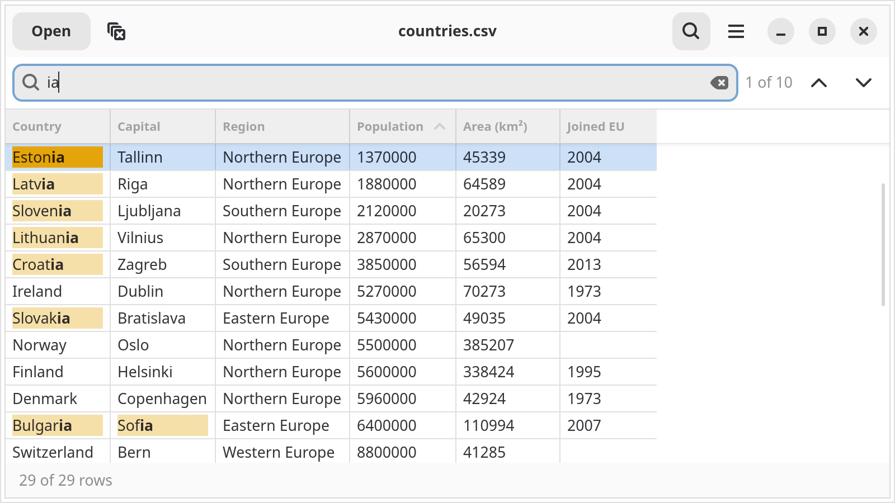

.. Reto — GitHub Pages landing page
.. role:: raw-html(raw)
   :format: html

.. Build: rst2html5 --stylesheet=_static/style.css --link-stylesheet --no-doc-title index.rst index.html

Reto
====

A simple, fast CSV file viewer for the GNOME desktop —
sort, filter and search your data in a table.

- :raw-html:`<a class="disabled" aria-disabled="true" title="Flathub review is in progress, see Installation for building the Flatpak yourself">Flatpak: coming soon</a>`
- `View on GitHub <https://github.com/ondratu/reto>`__
- `Other platforms <#installation>`__

   Reto — a CSV file sorted by a column, with the search matches marked.

Features
========

A viewer first: open a file and see your data.

Table with a header 📊
----------------------

The first row becomes the column titles, the rest of the file is shown
in a table.

Delimiter detection 🔎
----------------------

Comma, semicolon, tab or pipe — Reto finds the delimiter by itself and
ignores a byte order mark.

Sorting ↕️
----------

Sort by any column. Columns that contain only numbers are sorted as
numbers, not as text.

Filters 🎯
----------

Filter a column with few distinct values, such as a status or a country.
Reset the sorting and the filters with Ctrl+Shift+R.

Search 🔍
---------

Press Ctrl+F, see the matches marked in the table and jump between
them with F3 and Shift+F3.

Open anywhere 📂
----------------

Use the file chooser (Ctrl+O), drop a file on the window or pass it
on the command line.

Installation
============

Reto is being reviewed for `Flathub <https://github.com/flathub/flathub/pull/10847>`__,
so ``flatpak install flathub cz.zeropage.Reto`` does not work yet.
Until it is accepted, you can build the Flatpak from the manifest in the
pull request, on any Linux distribution that supports Flatpak:

.. code-block:: sh

   git clone --branch new-pr https://github.com/ondratu/flathub.git
   cd flathub
   flatpak-builder --user --install --install-deps-from=flathub \
                   --force-clean build-dir cz.zeropage.Reto.yaml
   flatpak run cz.zeropage.Reto

Debian / Ubuntu
---------------

Reto needs libadwaita 1.8 or newer, so use a recent release (Debian 14,
Ubuntu 26.04) or the Flatpak above. There is no package yet, build Reto
from source:

.. code-block:: sh

   sudo apt install build-essential meson valac git \
                    libgtk-4-dev libadwaita-1-dev

   git clone https://github.com/ondratu/reto.git
   cd reto
   meson setup build
   meson compile -C build
   sudo meson install -C build

Other distributions
-------------------

Reto is written in Vala and built with Meson. You need Meson, Ninja,
``valac``, GTK 4 (>= 4.12) and libadwaita (>= 1.8) development files.

.. code-block:: sh

   git clone https://github.com/ondratu/reto.git
   cd reto
   meson setup build
   meson compile -C build
   ./build/src/reto

Install it system wide with ``meson install -C build``.

Planned
=======

.. class:: callout-planned

.. admonition:: 🗺️ What comes next

   Character encodings, remembering the window size, copying cells and
   rows, resizable columns, several files in tabs and more. The full list,
   grouped by importance, is in the README.

   `See the plans on GitHub → <https://github.com/ondratu/reto#features>`__

Contribute
==========

.. class:: callout-bug

.. admonition:: 🐛 Found a bug or have a feature request?

   Open an issue on GitHub — the best way to report problems,
   suggest improvements, or start a discussion.

   `Open an Issue on GitHub → <https://github.com/ondratu/reto/issues>`__

.. class:: callout-donate

.. admonition:: ☕ Enjoying Reto?

   Reto is free, open-source software maintained in spare time.
   If it saves you time or makes your work easier, consider a small
   donation — it keeps the project going.

   `Donate via PayPal → <https://www.paypal.com/ncp/payment/E7Z8JVT3ZCETJ>`__

.. footer::

   **Reto** — MIT ·
   `GitHub <https://github.com/ondratu/reto>`__ ·
   `Issues <https://github.com/ondratu/reto/issues>`__ ·
   `Flathub (in review) <https://github.com/flathub/flathub/pull/10847>`__

   Made with ❤️ by `Ondřej Tůma <mailto:mcbig@zeropage.cz>`__ and
   `contributors <https://github.com/ondratu/reto/graphs/contributors>`__.
